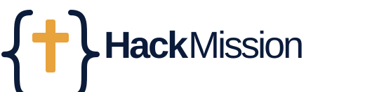

<p align="center">
  
</p>

# HackMission

[](LICENSE)
[](https://angular.dev)
[](https://dotnet.microsoft.com)
[](CONTRIBUTING.md)
[](CODE_OF_CONDUCT.md)

HackMission is a platform for recurring Christian hackathons. It brings developers, designers, and mission-driven organizations together for 48-hour weekends to build tools that serve churches, charities, and communities.

The platform begins with a public, consent-based event and mailing-list experience, then supports the full lifecycle of events: discovery, registration, challenges, teams, projects, demos, and organizer operations. It is a responsive full-stack web application with an [Angular](https://angular.dev) frontend and a [.NET](https://dotnet.microsoft.com) backend.

## What it does

- **Tell people about the next event.** Visitors can learn about upcoming HackMission weekends and join the mailing list with explicit, double opt-in consent.
- **Connect real needs with builders.** Churches, charities, and communities can bring challenges that teams turn into working prototypes.
- **Support every season.** Recurring events have their own dates, locations, schedules, registrations, teams, projects, and demos.
- **Welcome every contributor.** The experience is responsive and accessible for participants, partners, volunteers, and organizers.
- **Respect people’s data.** Mailing-list subscriptions have confirmation, one-click unsubscribe, and clear privacy information.

## How an event works

1. **Discover.** People find an upcoming HackMission weekend and hear the story behind it.
2. **Register.** Participants, volunteers, and partner organizations join an event.
3. **Bring challenges.** Partners share practical needs from churches, charities, and communities.
4. **Build.** Teams form and create useful prototypes over a focused 48-hour weekend.
5. **Demo and carry forward.** Teams present their work and organizers preserve projects and outcomes for the community.

## Architecture

| Layer | Technology | Responsibility |
| --- | --- | --- |
| Frontend | Angular (TypeScript) | Responsive public site and event experience for participants, partners, and organizers |
| Backend | .NET (C#, ASP.NET Core Web API) | REST API, authentication, authorization, event data, consent records, and integrations |
| End-to-end | Playwright | Browser behavior and accessibility coverage in Chromium |

The Angular app calls the ASP.NET Core API over HTTPS. The backend is the source of truth for authorization, event operations, and consent records.

## Getting started

HackMission is currently in the design phase. The commands below are the intended local workflow once the application projects are introduced.

### Prerequisites

- [Git](https://git-scm.com)
- [.NET SDK](https://dotnet.microsoft.com/download) (version pinned in `backend/global.json`)
- [Node.js LTS](https://nodejs.org) and npm

### Clone, install, and verify

```bash
git clone https://github.com/QuinntyneBrown/hackmission.git
cd hackmission/frontend
npm ci
npx playwright install chromium
npm run verify
```

`npm run verify` is the intended single command for formatting, building, and testing the backend and frontend, including Playwright. CI will run the same command.

### Run locally

```bash
# Terminal 1: from frontend
npm start

# Terminal 2: from the repository root
dotnet run --project backend/src/HackMission.Api
```

## Project structure

```text
hackmission/
├── backend/       .NET solution: API, Application, Domain, Infrastructure, and CLI
├── frontend/      Angular workspace: app shell, API client, components, and feature libraries
├── e2e/           Playwright page objects, fixtures, and feature specs
├── docs/          Journeys, specifications, mocks, design system, designs, estimates, and ADRs
├── eng/           Development, CI, deployment, and infrastructure scripts
├── tools/         Video and screen-recording tooling
└── AGENTS.md      Working agreement and mandatory repository structure
```

See [AGENTS.md](AGENTS.md) for the complete mandatory structure and architecture rules.

## Documentation

- [docs/mocks/README.md](docs/mocks/README.md) documents the current public-site visual reference.
- `docs/specs/` will hold L1/L2 requirements and acceptance criteria.
- `docs/detailed-designs/` will hold subsystem and feature designs.
- `docs/adr/` will record architecture and scope decisions.
- [AGENTS.md](AGENTS.md) is the working agreement for contributors and coding agents.

## Contributing

Contributions are welcome. Please read [CONTRIBUTING.md](CONTRIBUTING.md) before opening an issue or pull request.

## Code of conduct

This project has adopted the [Contributor Covenant](CODE_OF_CONDUCT.md). By participating, you are expected to uphold it.

## Security

Please do not report security vulnerabilities through public issues. See [SECURITY.md](SECURITY.md) for private reporting guidance.

## Support

See [SUPPORT.md](SUPPORT.md) for help and issue-reporting guidance.

## License

HackMission is licensed under the [MIT License](LICENSE).
